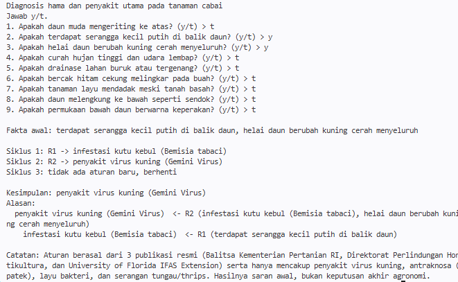
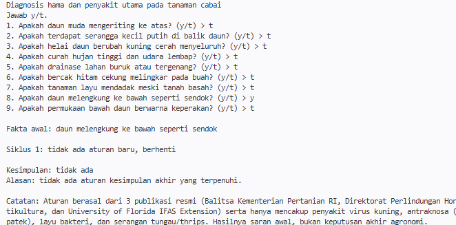
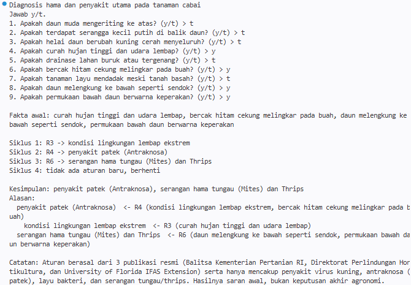

# Tugas 5 Kecerdasan Buatan: Sistem Pakar Diagnosis Hama dan Penyakit Tanaman Cabai

Aplikasi sistem pakar sederhana berbasis aturan (_Rule-Based Expert System_) untuk mengidentifikasi gangguan hama dan penyakit pada tanaman cabai (_Capsicum annuum_ L.).

## 1. Nama dan NIM

- **Nama**: Andre Astamam
- **NIM**: F1D02410103

## 2. Topik dan Cara Menjalankan Program

- **Topik Sistem Pakar**: Diagnosis hama dan penyakit utama pada tanaman cabai berdasarkan gejala morfologi daun, kondisi buah, serta faktor kelembapan lahan.
- **Bahasa & Versi**: Python 3 (Python 3.11)
- **Perintah Menjalankan Program**:
  1. Pastikan file `program_fc.py` dan `kb_cabai.json` berada pada satu direktori yang sama.
  2. Buka terminal atau Command Prompt pada direktori tersebut, lalu jalankan perintah:
     ```bash
     python program_fc.py
     ```
  3. Ketik `y` apabila gejala ditemukan pada tanaman atau `t` apabila gejala tidak ditemukan, lalu tekan Enter.

## 3. Daftar Sumber dan Tabel Aturan

### Sumber Pengetahuan

- **S1**: _Petunjuk Teknis Pengendalian Organisme Pengganggu Tumbuhan (OPT) Cabai_, Balai Penelitian Tanaman Sayuran (Balitsa) Kementerian Pertanian RI, https://balitsa.litbang.pertanian.go.id/, diakses 12 Nov 2026.
- **S2**: _Pepper Diseases and Pests Management Guide_, University of Florida IFAS Extension, https://edis.ifas.ufl.edu/publication/VH054, diakses 12 Nov 2026.
- **S3**: _Pedoman Pengenalan dan Pengendalian Virus Kuning dan Antraknosa pada Cabai_, Direktorat Perlindungan Hortikultura Kementan RI, https://hortikultura.pertanian.go.id/, diakses 12 Nov 2026.

### Tabel Aturan IF-THEN

| Aturan | IF                                                                                          | THEN                                                | Sumber |
| :----- | :------------------------------------------------------------------------------------------ | :-------------------------------------------------- | :----- |
| **R1** | IF daun muda mengeriting ke atas **OR** terdapat serangga kecil putih di balik daun         | THEN infestasi kutu kebul (Bemisia tabaci)          | S1     |
| **R2** | IF infestasi kutu kebul (Bemisia tabaci) **AND** helai daun berubah kuning cerah menyeluruh | THEN penyakit virus kuning (Gemini Virus)           | S3     |
| **R3** | IF curah hujan tinggi dan udara lembap **OR** drainase lahan buruk atau tergenang           | THEN kondisi lingkungan lembap ekstrem              | S2     |
| **R4** | IF kondisi lingkungan lembap ekstrem **AND** bercak hitam cekung melingkar pada buah        | THEN penyakit patek (Antraknosa)                    | S3     |
| **R5** | IF kondisi lingkungan lembap ekstrem **AND** tanaman layu mendadak meski tanah basah        | THEN penyakit layu bakteri (Ralstonia solanacearum) | S2     |
| **R6** | IF daun melengkung ke bawah seperti sendok **AND** permukaan bawah daun berwarna keperakan  | THEN serangan hama tungau (Mites) dan Thrips        | S1     |

Rantai aturan yang dijalankan:

- **R1** menghasilkan fakta antara `infestasi kutu kebul (Bemisia tabaci)` yang dipakai oleh **R2**.
- **R3** menghasilkan fakta antara `kondisi lingkungan lembap ekstrem` yang dipakai oleh **R4** dan **R5**.

## 4. Metode yang Dipilih dan Alasannya

- **Metode**: **Forward Chaining (FC)**
- **Alasan Pemilihan**: Petani atau pengamat di lapangan umumnya menemukan fakta-fakta gejala fisik secara langsung pada tanaman (misalnya bercak pada buah, daun menggulung, atau kondisi cuaca lembap) dan ingin mengetahui penyakit apa yang menyerang tanaman tersebut. Karena penelusuran dimulai dari kumpulan fakta gejala awal menuju kesimpulan diagnosis penyakit, metode _Forward Chaining_ sangat tepat digunakan dibandingkan _Backward Chaining_.

## 5. Tiga Kasus Uji dan Screenshot

| #     | Jawaban "ya"                                                                                                                                                   | Kesimpulan yang diharapkan                                           |
| :---- | :------------------------------------------------------------------------------------------------------------------------------------------------------------- | :------------------------------------------------------------------- |
| **1** | terdapat serangga kecil putih di balik daun, helai daun berubah kuning cerah menyeluruh                                                                        | penyakit virus kuning (Gemini Virus)                                 |
| **2** | daun melengkung ke bawah seperti sendok saja                                                                                                                   | **tidak ada** (kasus negatif)                                        |
| **3** | curah hujan tinggi dan udara lembap, bercak hitam cekung melingkar pada buah, daun melengkung ke bawah seperti sendok, permukaan bawah daun berwarna keperakan | penyakit patek (Antraknosa), serangan hama tungau (Mites) dan Thrips |

### Tangkapan Layar (Screenshot) Program

**Kasus Uji 1:**


**Kasus Uji 2 (Kasus Negatif):**


**Kasus Uji 3:**


## 6. Batas Keberlakuan

Basis pengetahuan pada program ini bersumber dari 3 dokumen panduan budidaya dan perlindungan tanaman (Balitsa Kementerian Pertanian RI, Direktorat Perlindungan Hortikultura Kementan RI, serta University of Florida IFAS Extension) yang difokuskan pada fase vegetatif dan generatif tanaman cabai di iklim tropis dan subtropis lembap. Cakupan diagnosis dibatasi hanya pada 4 jenis gangguan utama, yaitu penyakit virus kuning (_Gemini Virus_), penyakit patek (_Antraknosa_), penyakit layu bakteri (_Ralstonia solanacearum_), dan serangan hama tungau/_Thrips_. Keluaran dari aplikasi ini bersifat sebagai saran awal untuk identifikasi cepat di lapangan, bukan keputusan akhir agronomi yang menggantikan uji laboratorium patologi tanaman oleh penyuluh pertanian.

## 7. Penggunaan Alat Bantu AI

Alat bantu AI (Gemini) digunakan untuk membantu merapikan struktur JSON serta memeriksa penulisan fungsi pelacakan aturan (_alasan_) pada bahasa Python. Seluruh sumber literatur, perumusan tabel aturan IF-THEN, serta skenario pengujian dilakukan dan diverifikasi secara mandiri.
